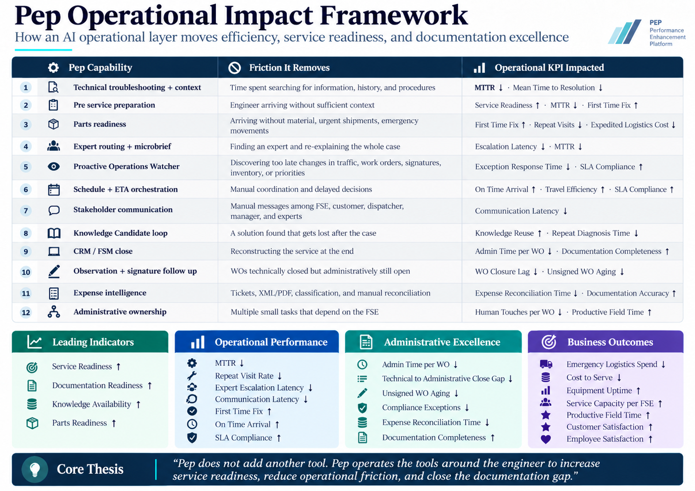
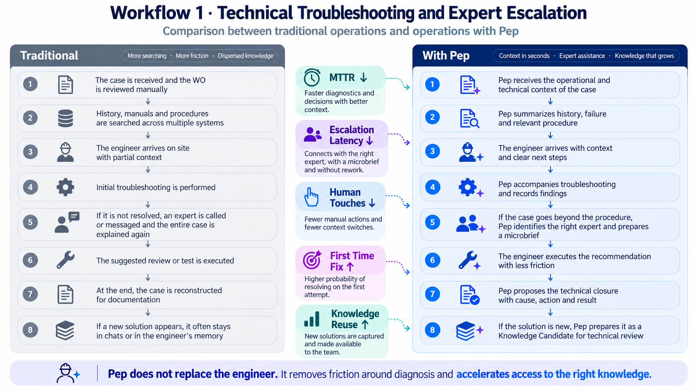
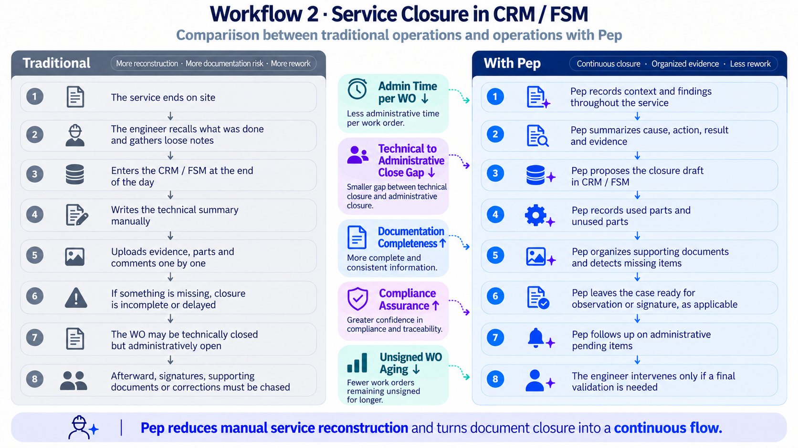
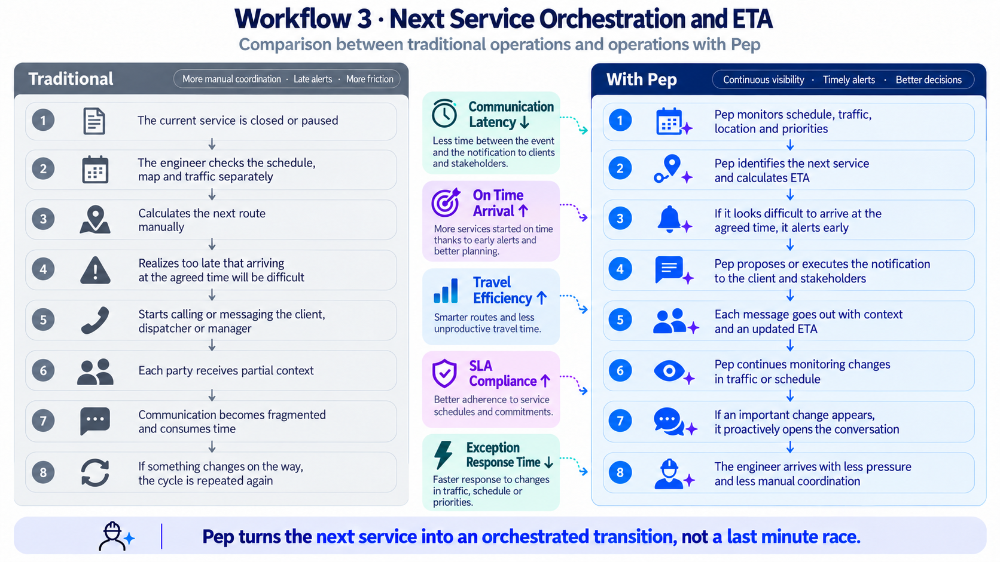
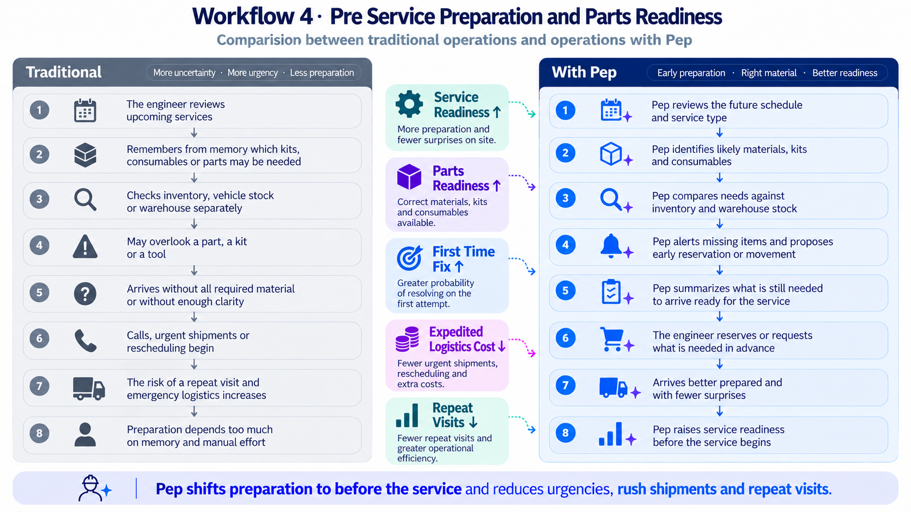
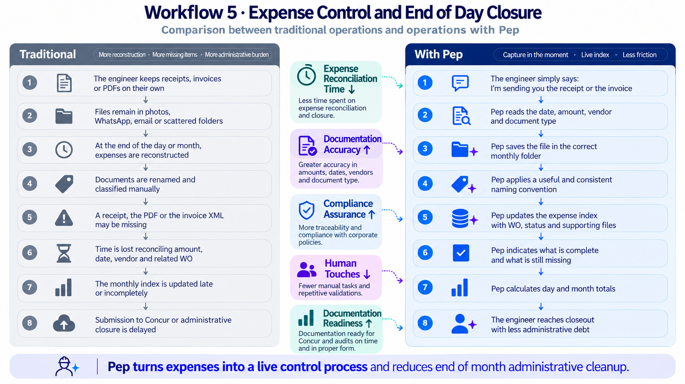
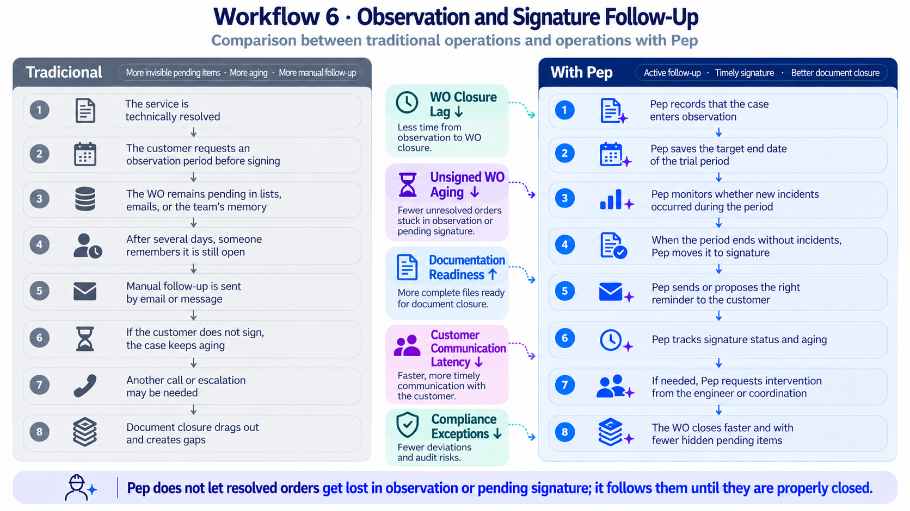

# PEP | Field Service Operating Layer

**Performance Enhancement Platform**

PEP is an AI operational layer designed around the real end to end workflow of the Field Service Engineer.

Its purpose is not to give the engineer another tool to operate. PEP is designed to coordinate the tools, information, people and administrative work surrounding the service so the engineer can focus on the work that actually requires technical expertise.

> **The engineer fixes the equipment. PEP protects the engineer's time.**

---

## Why I built it

Field Service organizations already have CRM, FSM, ERP, inventory, knowledge bases, scheduling, maps, communication tools, expense platforms and document systems.

The problem is not the absence of technology.

The problem is that the Field Service Engineer is often still the integration layer between all of them.

PEP explores a different operating model: one persistent AI layer that understands the engineer's context across the entire service lifecycle, anticipates needs, orchestrates actions, maintains documentation and follows operational exceptions until human judgment is actually required.

---

## PEP Operational Impact Framework

PEP is designed to influence a connected set of operational indicators rather than a single isolated KPI.

These are impact hypotheses to be validated through real operational pilots. They are not presented as measured production results.

---

# What PEP currently demonstrates

## 1. Technical Troubleshooting and Expert Escalation

PEP maintains the technical context of the active service, retrieves the relevant procedure, guides troubleshooting and avoids repeatedly asking for information that has already been established.

When the documented procedure is exhausted, PEP can identify the most relevant available expert, prepare a microbrief and preserve the resulting solution as a Knowledge Candidate for technical review.

---

## 2. Service Closure in CRM / FSM

PEP progressively captures cause, actions, findings, parts usage, validation and technical outcome during the service.

Instead of forcing the engineer to reconstruct the entire case at the end of the day, the information is already organized and ready for administrative closure.

---

## 3. Next Service Orchestration and ETA

PEP understands the engineer's next assignment, service commitment and operational context.

It can identify potential delays, prepare customer and stakeholder communication and maintain continuity as conditions change.

---

## 4. Pre Service Preparation and Parts Readiness

PEP reviews upcoming services, expected requirements and available inventory before the engineer arrives on site.

The objective is to increase Service Readiness, reduce urgent logistics and improve the probability of resolving the service correctly on the first visit.

---

## 5. Expense Control and Documentation

PEP can organize the expense workflow around the engineer rather than requiring the engineer to reconstruct it later.

The operating concept includes receipt and invoice capture, classification, document completeness, Work Order association, monthly expense indexing and exception tracking.

---

## 6. Observation and Signature Follow Up

A technically resolved service is not necessarily administratively closed.

PEP tracks observation periods, customer signature status, reminders and pending documentation, maintaining ownership of the follow up until human intervention is actually required.

---

# Proactive Operations Watcher

PEP is designed to evolve beyond a reactive copilot.

The architecture includes the concept of a proactive operational watcher capable of monitoring changes across sources such as traffic and ETA, service schedules, new or reassigned Work Orders, parts availability, customer signatures, observation periods, inventory exceptions and operational priorities.

The objective is not to generate more alerts.

The objective is to understand whether a change is relevant enough to alter the Field Service Engineer's next decision.

The operating pattern is:

**Event → Context → Relevance → Decision → Action or Silence**

A strong operational agent should know when to act, when to ask and when not to interrupt.

---

# Operational Impact

PEP is designed to influence several connected layers of operational performance.

## Leading Indicators

- Service Readiness ↑
- Parts Readiness ↑
- Documentation Readiness ↑
- Knowledge Availability ↑

## Operational Performance

- MTTR ↓
- Expert Escalation Latency ↓
- Communication Latency ↓
- Repeat Visit Rate ↓
- First Time Fix ↑
- On Time Arrival ↑
- SLA Compliance ↑

## Administrative Excellence

- Admin Time per Work Order ↓
- Technical to Administrative Close Gap ↓
- Unsigned Work Order Aging ↓
- Expense Reconciliation Time ↓
- Compliance Exceptions ↓
- Documentation Completeness ↑
- Traceability ↑
- Audit Readiness ↑
- Compliance Assurance ↑

## Business Outcomes

- Equipment Uptime ↑
- Service Capacity per Field Service Engineer ↑
- Productive Field Time ↑
- Customer Satisfaction ↑
- Employee Satisfaction ↑
- Emergency Logistics Spend ↓
- Cost to Serve ↓

These metrics represent expected areas of impact and should be validated through production pilots.

---

# Core Thesis

Modern Field Service does not suffer from a lack of software.

It suffers from operational fragmentation.

The next generation of Field Service AI should not simply make every individual system easier to use. It should understand the work well enough to reduce how often the engineer needs to operate those systems in the first place.

PEP is an exploration of that operating model.

> **The engineer should not work for the tools. The tools should work around the engineer.**

---

# Current Status

PEP is currently an interactive prototype demonstrating the operating model and conversational orchestration layer.

A production deployment would require authenticated integrations with enterprise systems such as CRM, FSM, inventory, scheduling, communications, traffic data, document management, digital signature and expense platforms.

The current MedTech demonstration uses fictional equipment, customers and technical scenarios. It is intended to demonstrate AI architecture and operational workflows and is not manufacturer technical guidance or a medical device.

---

# Live Demo

**Public interactive demo link coming soon.**

---

# Project Article

A complete case study covering the operating thesis, six transformed workflows and the PEP Operational Impact Framework accompanies this project.

---

# Author

**Fernando Javier Morales Begué**

Applied AI · AI Deployment · Forward Deployed Engineering · Deployment Strategy

[LinkedIn](https://www.linkedin.com/in/fernando-begue/)

---

# Project Ownership

PEP and the materials contained in this repository are an independent project by Fernando Javier Morales Begué.

No open source license is currently granted. All rights are reserved unless explicitly stated otherwise.
